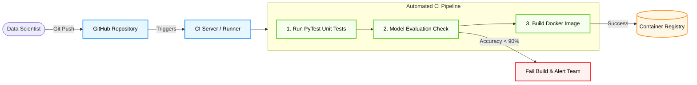
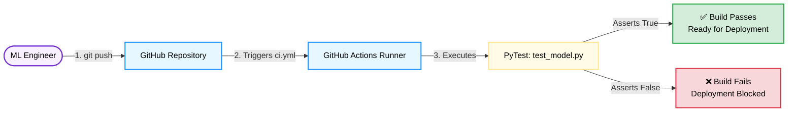

# Continuous Integration Pipelines

**Session Time:** 120 minutes

---

## Module Overview

Explore continuous integration (CI) pipelines and how they streamline model and system updates. Moving from a prototype to production can be challenging, often creating deployment bottlenecks. Learn to automate testing, build verification, and deployment workflows for reliability, ensuring that every code or model change is systematically validated before it reaches your users.

---

## Session Breakdown

| Segment | Topic                                   | Duration (minutes) |
|---------|-----------------------------------------|--------------------|
| 1       | Introduction & Automating Model Testing | 20                 |
| 2       | Building a Simple CI Workflow & Tooling | 30                 |
| 3       | Evaluating the Impact on Reliability    | 10                 |
| 4       | Lab: Pipeline Builder                   | 60                 |

---

## Table of Contents
1. Automating Model Testing and Deployment
2. Building a Simple CI Workflow
3. Evaluating the Impact of Automation
4. Tooling Deep Dive: PyTest, GitHub Actions, and Kubernetes
5. Lab Reference: Pipeline Builder
6. Wrap-Up and Reflection

---

## 1. Automating Model Testing and Deployment

**Learning Objective:** Describe how CI pipelines automate model testing and deployment.

In traditional software engineering, Continuous Integration (CI) means automatically building and testing code every time a developer commits a change. In AI Systems Engineering, CI is more complex. You are not just testing Python logic; you are validating the "Evaluation & Validation" metrics of the model itself. 

A robust ML CI pipeline automatically verifies that new model weights meet accuracy thresholds, that the input data schema hasn't drifted, and that the inference latency remains within acceptable Service Level Objectives (SLOs).


### **Practical Example: The "Poisoned" Pull Request**
A data scientist on your team fine-tunes a churn prediction model and pushes the updated `model.pkl` file to the main branch. However, they accidentally trained it on a dataset missing the `customer_age` column. Without CI, this broken model deploys, and the production API crashes. *With* a CI pipeline, the automated system intercepts the commit, runs a schema validation script, detects the missing feature, fails the build, and blocks the deployment. The pipeline catches the error before the customer ever experiences it.

---

## 2. Building a Simple CI Workflow

**Learning Objective:** Build a simple CI workflow using open-source tools.

Building a CI workflow involves linking triggers (e.g., a code commit) to automated jobs (e.g., running tests, building a Docker image). Modern platforms allow you to define these workflows declaratively using YAML files.



To build reliable AI systems, you need to ensure that every code or model update is systematically validated before it reaches your users. This is where **PyTest** and **GitHub Actions** work together to automate the "Deployment & Monitoring" phase of your machine learning workflow.


### PyTest (The Testing Framework)

**PyTest** is a mature, fully-featured Python testing framework. In traditional software, you test business logic. In an AI context, you use PyTest to validate data preprocessing functions, check input data schemas, and ensure your model's inference endpoints return the correct data types and shapes.

**Practical Example:**
Imagine you have a function `predict_churn(customer_data)` that should always return a probability between 0.0 and 1.0. You write a PyTest script (`test_model.py`) to automatically verify this behavior.

```python
# test_model.py
import pytest
from my_ml_app import predict_churn

def test_predict_churn_output_bounds():
    # 1. Provide mock input data
    mock_customer = {"age": 35, "monthly_spend": 120}
    
    # 2. Get the model's prediction
    prediction = predict_churn(mock_customer)
    
    # 3. Assert the prediction is a float and within valid probability bounds
    assert isinstance(prediction, float)
    assert 0.0 <= prediction <= 1.0

```

### GitHub Actions (The Automation Engine)

**GitHub Actions** is a Continuous Integration and Continuous Deployment (CI/CD) platform integrated directly into GitHub. It allows you to define automated workflows using declarative YAML files. Instead of running `pytest` manually on your laptop (which is prone to human error), GitHub Actions provisions a temporary server to run your test suite every time a developer pushes new code.

**Practical Example:**
You create a configuration file in your repository at `.github/workflows/ci.yml`. This file tells GitHub: *"Every time someone pushes code to the main branch, spin up an Ubuntu server, install Python, and run my PyTest suite."*

```yaml
# .github/workflows/ci.yml
name: AI Model CI Pipeline

on:
  push:
    branches: [ "main" ]

jobs:
  test-model:
    runs-on: ubuntu-latest
    
    steps:
    - name: Check out the repository code
      uses: actions/checkout@v3

    - name: Set up Python 3.9
      uses: actions/setup-python@v4
      with:
        python-version: "3.9"

    - name: Install dependencies
      run: |
        pip install -r requirements.txt
        pip install pytest

    - name: Run PyTest suite
      run: pytest test_model.py

```

### How They Work Together

PyTest provides the *logic* to verify your system is healthy, while GitHub Actions provides the *infrastructure* to ensure those checks are executed consistently. 

If PyTest encounters an error (e.g., your model returns a string instead of a float), GitHub Actions will detect the failed test, mark the commit with a red "X", and block the broken model from being deployed to production.




### **Practical Example: The YAML Blueprint**
To build this, you write a configuration file stored directly in your repository (e.g., `.github/workflows/ci.yml`). This file dictates that every time a pull request is opened, an isolated server spins up, installs the dependencies listed in `requirements.txt`, runs the tests, and reports the green checkmark (success) or red cross (failure) back to the GitHub UI.

---

## 3. Evaluating the Impact of Automation

**Learning Objective:** Evaluate the impact of automation on reliability and deployment speed.

Manual deployments require an engineer to SSH into a server, pull code, install packages, and restart services. This introduces massive operational risk. Automation eliminates human error, directly mitigating deployment bottlenecks.

* **Reliability:** CI ensures that *every* deployment goes through the exact same rigorous validation process. There are no skipped steps because an engineer was in a rush.
* **Speed:** By removing manual QA bottlenecks, teams can deploy small, incremental updates multiple times a day rather than batching massive, risky updates once a month.

**Practical Example: The Friday Afternoon Deploy**
Without CI, deploying a model update on a Friday afternoon is terrifying because a manual mistake could mean working all weekend. With a robust CI/CD pipeline, the system automatically runs a comprehensive test suite. If the tests pass, the team knows with mathematical certainty that the core application logic is sound, making Friday deployments routine and stress-free.

---

## 4. Tooling Deep Dive: PyTest, GitHub Actions, and Kubernetes

To execute these CI/CD workflows, engineers orchestrate a combination of specialized tools.

### **PyTest (The Testing Framework)**

PyTest is a mature, fully-featured Python testing tool that helps you write better programs. In an ML context, it is used to write unit tests for data preprocessing functions and integration tests for model endpoints.

* **Practical Example:** You write a `test_inference.py` script using PyTest that sends a mock JSON payload to your model function. The test asserts that the model returns a predicted value between 0 and 1. The CI pipeline runs this test automatically.

### **GitHub Actions (The CI/CD Runner)**

GitHub Actions makes it easy to automate all your software workflows directly from GitHub. It provisions the temporary servers that run your CI pipelines.

* **Practical Example:** You configure a GitHub Action to listen for any push to the `main` branch. When triggered, the Action spins up an Ubuntu virtual machine, checks out your code, runs your PyTest suite, and if successful, builds a Docker image of your model API.

### **Kubernetes (The Deployment Target)**

Kubernetes (K8s) is an open-source system for automating deployment, scaling, and management of containerized applications. It acts as the highly reliable destination for your CI pipeline's output.

* **Practical Example:** After GitHub Actions successfully builds and tests your Docker image, the final step of the pipeline pushes that image to a registry and updates your Kubernetes cluster. Kubernetes then automatically performs a "rolling update," spinning up the new version of your model and gradually routing user traffic to it while tearing down the old version, ensuring zero downtime.

---

## 5. Lab Reference: Pipeline Builder

**Lab Objective:** Create a simple CI/CD pipeline that builds and deploys a Docker app automatically. Learners experience how automation reduces human error and improves release speed.

*Note: Please refer to the dedicated Lab Guide for the YAML starter templates, GitHub repository setup instructions, and Kubernetes cluster access details.*

**Tools Required:**

* PyTest
* GitHub Actions
* Kubernetes (via Minikube or cloud provider)

---

## Wrap-Up and Reflection

**Reflection Questions:**

1. How does a CI pipeline change the code review process between a Data Scientist and an ML Engineer?
2. If your automated tests pass, but the deployed model still degrades in production, what observability tools from our previous modules would you use to catch the issue?

---

## Resources

* [GitHub Actions Documentation](https://docs.github.com/en/actions)
* [PyTest Official Documentation](https://docs.pytest.org/)
* [Kubernetes Basics](https://kubernetes.io/docs/tutorials/kubernetes-basics/)
