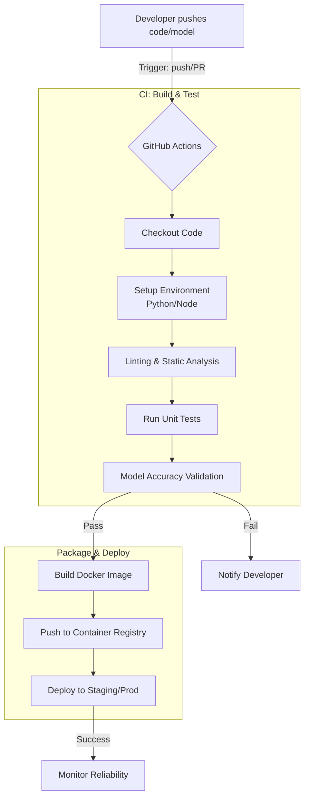

# Continuous Integration Pipelines: Automating AI Reliability

**Session Time:** 120 minutes

---

## Table of Contents
1. The Role of CI in AI Systems Engineering
2. Automating Model Testing and Deployment
3. Building Workflows with GitHub Actions and Docker
4. Evaluating Automation Impact on Reliability
5. Lab: Pipeline Builder
6. Wrap-Up and Reflection

---

## Learning Objectives

By the end of this module, participants will be able to:

1. **Describe** how CI pipelines automate model testing and deployment to ensure system integrity.
2. **Build** a functional CI workflow using GitHub Actions and Docker to containerize and verify AI applications.
3. **Evaluate** the impact of automation on system reliability and deployment velocity within an MLOps context.

---

## Session Breakdown

| Segment | Topic                                             | Duration (minutes) |
|---------|---------------------------------------------------|--------------------|
| 1       | The Role of CI in AI Systems Engineering          | 15                 |
| 2       | Automating Model Testing and Deployment           | 25                 |
| 3       | Building Workflows with GitHub Actions and Docker | 20                 |
| 4       | Evaluating Automation Impact on Reliability       | 60                 |

*(Note: The above table aggregates the lab time into the final segment to match the 120-minute total)*

---

## 1. The Role of CI in AI Systems Engineering

In the context of **AI Systems Engineering & Reliability**, CI/CD is the engine that ensures your models and infrastructure are robust, reproducible, and ready for production.

### What is Continuous Integration (CI)?

The practice of automating the integration of code changes from multiple contributors into a single software project. For AI, this includes running **Unit Tests** (code logic) and **Model Validation** (accuracy/drift checks). Unlike traditional software, AI CI must account for **data validation** and **model performance regression**.

---

## 2. Automating Model Testing and Deployment

Automation removes the "manual hand-off" risk. When a data scientist pushes a new model version or an engineer updates the API wrapper, the pipeline immediately triggers a suite of tests to ensure the system doesn't break.

### GitHub Actions: The Orchestrator

GitHub Actions is the tool that executes these steps. It uses **Workflows** (YAML files) to listen for events like a `git push` and then triggers **Jobs** on virtual machines called **Runners**.

### CI/CD Workflow Diagram

This diagram visualizes how a code change travels from a developer's machine to a live environment using GitHub Actions and Docker.



### Key Tools in the Pipeline:

1. **GitHub Actions:** 
   
   Acts as the "Control Plane" of your automation.
2. **Docker:** 
   
   Ensures the "Environment" is identical across testing and production. Specifically, Docker ensures the *inference environment* matches the *training environment*—including Python versions, library versions, and CUDA drivers. A model trained with scikit-learn 1.3 will silently produce wrong results if deployed against scikit-learn 1.1, making Docker crucial for preventing this ML-specific mismatch.
3. **Pytest:** 
   
   Used within the pipeline to validate code and data quality.

---

## 3. Building Workflows with GitHub Actions and Docker

To move from theory to practice, we utilize **GitHub Actions** for orchestration and **Docker** for environment consistency.

### Practical Example: A Simple CI YAML

You might manage a workflow that builds a Docker image only if the Python tests pass. As a reliability engineer, you wouldn't just test if the code "runs"—you'd test if the model meets a specific **Reliability Threshold**.

**File:** `.github/workflows/verify-ai-system.yml`

```yaml
# .github/workflows/ai-ci-pipeline.yml
name: AI System CI

on: [push]

jobs:
  test-and-build:
    runs-on: ubuntu-latest
    steps:
      - name: Checkout Code
        uses: actions/checkout@v3

      - name: Set up Python
        uses: actions/setup-python@v4
        with:
          python-version: '3.9'

      - name: Install Dependencies
        run: pip install -r requirements.txt

      - name: Reliability Gate (Accuracy & Latency)
        run: |
          # Custom script to ensure model latency < 200ms 
          # and accuracy > 92%
          python scripts/verify_metrics.py 

      - name: Build Docker Image
        if: success()
        run: docker build -t ai-service:latest .
```

### Understanding the `verify_metrics.py` Reliability Gate
The `verify_metrics.py` script serves as the reliability gate for the pipeline. This script connects directly to observability concepts by checking specific accuracy and latency thresholds—the very same metrics surfaced by Prometheus Gauges and Histograms covered in earlier labs. If the metrics fall below the defined thresholds, the script uses exit code conventions to fail the workflow, ensuring a degraded model does not reach production.

### Local Testing with `act`
If you are working in a restricted environment (like a corporate firewall) or simply want to test your workflow locally before pushing to GitHub, you can use a tool called `act`. 

> `act` runs GitHub Actions workflows locally using Docker, reducing the friction of slow feedback loops caused by runner queue times.

---

## 4. Evaluating Automation Impact on Reliability

Automation is not just about speed; it is a primary driver of **Reliability Engineering**. The focus shifts from "how to build" to "how it impacts the bottom line".

### Key Reliability Metrics (DORA Framework)
These metrics belong to the DORA (DevOps Research and Assessment) framework. For extended reading, refer to the DORA State of DevOps Report.

| Metric                           | Definition                                | Impact of CI                                                           |
|----------------------------------|-------------------------------------------|------------------------------------------------------------------------|
| **Mean Time to Recovery (MTTR)** | Time taken to fix a failure.              | Decreased: Automated rollbacks and fast builds resolve issues quicker. |
| **Change Failure Rate**          | % of changes leading to degraded service. | Decreased: Automated testing catches bugs before they ship.            |
| **Deployment Frequency**         | How often code is successfully deployed.  | Increased: Confidence in automation allows for more frequent updates.  |

### Practical Scenario: The "Silent Failure"

Imagine a model update that passes code linting but has a 20% drop in accuracy. A robust CI pipeline includes a **Model Threshold Gate**. If the `accuracy_score < 0.85`, the Docker build is killed, preventing a "broken" brain from being deployed to your users.

---

## 5. Lab: Pipeline Builder

**Objective:** Create a simple CI/CD pipeline that builds and deploys a Docker app automatically. Learners experience how automation reduces human error and improves release speed.

> [!NOTE]
>
> [**Lab: Pipeline Builder**](https://github.com/ga-curriculum/lab-7-pipeline-builder)
> 
> **Note**: Please refer to the dedicated [**lab guide**](https://github.com/ga-curriculum/lab-7-pipeline-builder)
 for full instructions, architectural constraints, and deliverables.

---

## 6. Wrap-Up and Reflection

**Reflection Questions:**

1. How does containerizing an AI model with Docker specifically address the "Environment Drift" problem in reliability?
2. In your current organization, what is the most manual (and therefore risky) part of your deployment process that could be handled by a GitHub Action?