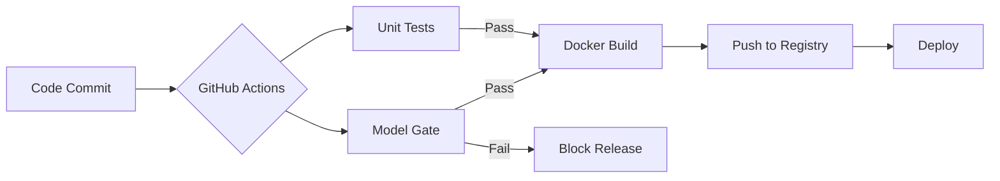

# Instructor Guide: Continuous Integration Pipelines

## Module Overview

In this module, professionals will explore the critical role of CI pipelines in AI Systems Engineering. The focus is on moving beyond simple code integration to "Reliability-First" automation, where model performance, data integrity, and environment consistency (via Docker) are validated automatically before any deployment occurs.

## Learning Objectives

By the end of this session, students will be able to:

* **Describe** how CI pipelines automate model testing and deployment to ensure system integrity.
* **Build** a functional CI workflow using GitHub Actions and Docker to containerize and verify AI applications.
* **Evaluate** the impact of automation on system reliability and deployment velocity.

## Session Pacing Guide (120 Minutes total)

| Duration   | Segment                     | Instructor Action                                                                                                                                                                                                                                                          |
|------------|-----------------------------|----------------------------------------------------------------------------------------------------------------------------------------------------------------------------------------------------------------------------------------------------------------------------|
| **20 min** | **CI in the AI Lifecycle**  | Discuss the difference between traditional CI and AI CI (testing code vs. testing models/data). Use a diagram to show the feedback loop.                                                                                                                                   |
| **40 min** | **GitHub Actions & Docker** | Live demo: Focus on *reading* and *interpreting* a workflow rather than authoring one live. Show a failing build due to a "Model Accuracy" test and build a Docker image. It is highly recommended to use a pre-prepared repository with a failing workflow ready to show. |
| **60 min** | **Lab: Pipeline Builder**   | Facilitate the lab where students build their own CI pipeline. Assist with YAML syntax and Docker daemon issues.                                                                                                                                                           |

---

## Delivery Notes & Teaching Tips

### 1. Automation as a Reliability Tool

* **The "Safety Net" Analogy:** Explain that CI is not about "working faster," but about "failing faster" in a controlled environment.
* **Career Context:** Professionals often worry about the overhead of CI. Emphasize that the initial setup time is an investment that prevents "3 AM production outages" caused by human error.

### 2. The CI/CD Flow

---

## Common Student Issues & Solutions

| Issue                             | Potential Cause                                                              | Solution                                                                                                                                                                                |
|-----------------------------------|------------------------------------------------------------------------------|-----------------------------------------------------------------------------------------------------------------------------------------------------------------------------------------|
| **Action fails on "Permissions"** | The GITHUB_TOKEN doesn't have write access to the repository or packages.    | Navigate to **Settings > Actions > General** and ensure "Read and write permissions" are enabled.                                                                                       |
| **Docker Build is slow**          | Not utilizing Docker Layer Caching in the CI runner.                         | Introduce the `docker/build-push-action` with cache-from and cache-to parameters.                                                                                                       |
| **YAML Syntax Errors**            | Incorrect indentation (common with pros new to YAML).                        | Recommend using `actionlint`, which is a purpose-built linter that catches GitHub Actions-specific errors generic linters might miss. Remind them: "Spaces matter, tabs are forbidden". |
| **Model Test Flakiness**          | Model performance fluctuates slightly on different hardware or random seeds. | Teach students to use fixed random seeds and "tolerance ranges" (e.g., `assert accuracy > 0.80`) rather than exact matches.                                                             |
| **Docker image too large**        | Including datasets or heavy virtual environments in the image.               | Use `.dockerignore` to exclude data folders and explain "Multi-stage builds".                                                                                                           |

---

## Debrief Questions

1. "If a model passes all code unit tests but drops 5% in accuracy, should the CI pipeline fail? Why?"
2. "How does using Docker prevent the 'It worked on my machine' excuse during a production failure?"
3. "What is one manual step in your current work process that could be automated by a GitHub Action tomorrow?"

---

## Resources for the Instructor

* **Reference:** 
  * [GitHub Actions Documentation](https://docs.github.com/en/actions)
  * [Docker Best Practices for Python/AI](https://docs.docker.com/language/python/)
  * [actionlint Repository](https://github.com/rhysd/actionlint)
* **AI Prompt Bank:**
  * *"Create a GitHub Action YAML that runs pytest and then builds a Docker image only if tests pass."*
  * *"Explain the difference between a 'Runner' and a 'Workflow' in GitHub Actions."*
