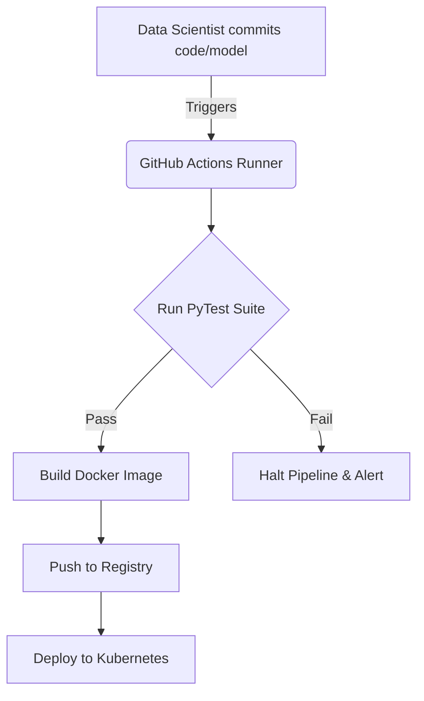

# Instructor Guide: Continuous Integration Pipelines

## Module Overview
In this module, instructors will guide students through the mechanics of Continuous Integration (CI) and Continuous Deployment (CD) within an AI context. Moving a machine learning model from a prototype to a production environment is a major bottleneck. This session teaches mid-career professionals how to automate testing, build verification, and deployment workflows using PyTest, GitHub Actions, and Kubernetes to drastically reduce operational risk and human error.

## Learning Objectives
By the end of this session, students will be able to:
* Describe how CI pipelines automate model testing and deployment.
* Build a simple CI workflow using open-source tools.
* Evaluate the impact of automation on reliability and deployment speed.

## Session Pacing Guide (120 Minutes total)

| Duration   | Segment                            | Instructor Action                                                                                                                        |
|:-----------|:-----------------------------------|:-----------------------------------------------------------------------------------------------------------------------------------------|
| **10 min** | **Introduction & Module Overview** | Hook the class: Ask who has ever broken production because they forgot to run a test script locally before deploying.                    |
| **20 min** | **Automating Model Testing**       | Discuss the difference between traditional software tests (logic) and ML tests (data shapes, schema validation, evaluation metrics).     |
| **30 min** | **Building a Workflow & Tooling**  | Live whiteboard the CI/CD architecture. Show a minimal `.github/workflows/main.yml` file and explain how GitHub Actions triggers PyTest. |
| **60 min** | **Lab: Pipeline Builder**          | Facilitate the hands-on lab. Assist students with YAML formatting, GitHub Secrets, and reading build logs.                               |

---

## Delivery Notes & Teaching Tips

### 1. Automating Model Testing and Deployment
* **The "Shift Left" Concept:** Mid-career professionals need to understand that CI forces quality checks earlier in the process (shifting left). If a model fails an evaluation metric (like falling below a baseline F1-score), the build should break *before* it ever reaches the container registry.
* **Visual Aid:**  Use this to show the hard boundary between the developer's laptop and the deployment target. 

### 2. Building a Simple CI Workflow (The Tooling)
* **Demystifying the Magic:** CI platforms can seem like magic to data scientists. Break it down: GitHub Actions is literally just an on-demand virtual machine (usually Ubuntu) that checks out their code and runs bash commands sequentially. 
* **Whiteboarding the Flow:** Draw this out or use the Mermaid diagram below to explain the sequence of operations.

### 3. Evaluating the Impact on Reliability

* **Culture Shift:** Emphasize that automation changes team dynamics. It removes the "gatekeeper" mentality where one senior engineer does all deployments manually, empowering the whole team to deploy safely while mitigating deployment bottlenecks.

---

## Lab Guide: Pipeline Builder

**Lab Objective:** Create a simple CI/CD pipeline that builds and deploys a Docker app automatically using GitHub Actions and Kubernetes. Learners experience how automation reduces human error and improves release speed.

### Setup

* Ensure students have their GitHub accounts ready.
* Ensure students have access to the starter repository containing a basic Python ML API and a `test_api.py` file.
* Provide the required GitHub Secrets (e.g., Docker Hub tokens) needed to push images during the lab.

### Common Student Issues & Solutions

| Student Issue                                                               | Root Cause                                                                                                      | Instructor Solution                                                                                                                                                                                        |
|-----------------------------------------------------------------------------|-----------------------------------------------------------------------------------------------------------------|------------------------------------------------------------------------------------------------------------------------------------------------------------------------------------------------------------|
| **"My GitHub Action failed with a YAML parsing error."**                    | YAML is strictly reliant on spaces (not tabs) for indentation. A single misaligned block breaks the workflow.   | Have the student use an IDE with a YAML formatter (like VS Code) or point out the exact line number referenced in the GitHub Actions error log.                                                            |
| **"The PyTest step failed, but my Docker image still built and deployed!"** | The pipeline steps are not correctly chained, or the test script is returning a `0` exit code even on failure.  | Ensure the `build` step explicitly depends on the `test` step in the workflow file. Teach them how to properly assert failures in PyTest.                                                                  |
| **"Authentication failed when pushing the Docker image."**                  | The `DOCKER_USERNAME` or `DOCKER_PASSWORD` secrets are missing or incorrectly named in the repository settings. | Walk them through the Repository Settings -> Secrets and Variables -> Actions menu to verify their credentials are injected properly.                                                                      |
| **"The AI gave me a GitHub Actions syntax that doesn't exist."**            | AI models sometimes hallucinate deprecated CI syntax or mix GitLab CI syntax with GitHub Actions.               | If the AI gives a complex or weird answer for a CI configuration, teach students to cross-reference. "Ask the AI: *'Are you sure? Can you verify that against the latest GitHub Actions documentation?'*". |

### Debrief Questions

At the end of the lab, ask:

1. "In our lab, we tested the API endpoint's response. How would you modify this pipeline to test the *accuracy* of the model using a validation dataset before deployment?"
2. "Why is it important to have your CI pipeline build a fresh Docker image rather than pushing an image built on your local laptop?"

---

## Resources for the Instructor

* **Reference:** 
  * [GitHub Actions: Understanding the CI/CD Workflow](https://docs.github.com/en/actions/learn-github-actions/understanding-github-actions)
  * [PyTest Fixtures and Best Practices](https://docs.pytest.org/en/6.2.x/fixture.html)
* **AI Prompt Bank:** Keep these handy to share with students who are stuck:
  * *"Write a GitHub Actions YAML step to install Python 3.9 and install dependencies from a requirements.txt file."*
  * *"How do I write a PyTest function to check if a Pandas DataFrame has any missing values before passing it to my machine learning model?"*